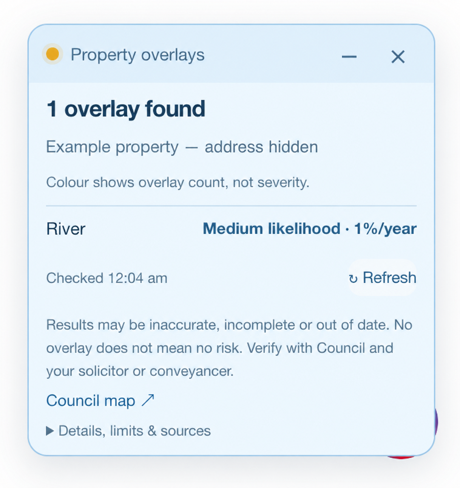

# Brisbane Real Estate Overlay

A Chrome/Helium extension that checks **flood, bushfire and landslide mapping** alongside property listings on **realestate.com.au, Domain, Quiet Listings, Homely and OnTheHouse**. It uses Brisbane City Council’s public spatial data, with a compact combined traffic-light card and a separate manual City Plan flood-overlay lookup. Version 0.8.2 includes small traffic-light badges on open map previews on all five sites and keeps confirmed overlays coloured when another check is unavailable.

**Beta · Brisbane City Council area only.** Coverage does not extend to all of Greater Brisbane or Queensland.

No account or coding knowledge is needed to use the extension.

*Example interface with the address removed. Results are illustrative and should not be relied on for a particular property.*

**General information only.** Results may be inaccurate, incomplete or out of date because of errors in source mapping, address matching or this extension’s processing. No overlay found does not mean a property is safe or free from hazards. Confirm the displayed property and verify with Council’s maps and relevant property reports before making buying, renting, insurance or development decisions. Discuss any property implications with your solicitor or conveyancer. Do not rely on this extension alone; seek other qualified advice where needed.

## Install in Helium or Chrome

**[Install from the Chrome Web Store](https://chromewebstore.google.com/detail/brisbane-real-estate-over/nmngllhcapehfgbmjnokicbcapklngeb).** This README describes version 0.8.2. The manual installation below lets you use the version in this repository.

To install the latest code from GitHub manually:

1. On this GitHub page, choose **Code → Download ZIP**, then extract the downloaded file.
2. Open `chrome://extensions` in your browser.
3. Enable **Developer mode**.
4. Click **Load unpacked** and select the extracted folder containing `manifest.json`.
5. Allow access to the supported listing sites if prompted.
6. Open or refresh an individual property listing on any supported site.

The property overlay card appears at the bottom right. Use **−** to minimise it and **+** to expand it. If you dismiss it with **×**, refresh the listing page to bring it back. Pin the extension in the toolbar to access the manual City Plan lookup.

For a manual installation, keep the extracted extension folder on your computer. Updates are manual: download the new version, replace the files in that folder, click **Reload** on its extensions card, and refresh any open listing tabs.

## Listing card

The extension reads the listing heading or structured address metadata. An exact, unique street-address match is checked automatically. Unit addresses, partial matches and ambiguous results ask you to select the appropriate Council property holding. If detection fails, you can enter an address manually.

The card checks six overlay types: **river, creek, storm tide, overland flow, bushfire and landslide**. Its colour counts the types intersecting any part of the selected property holding. Each type counts once, regardless of the number of polygons or subcategories. Flood rows retain the highest mapped category for each source.

| Light | Meaning in this extension |
| --- | --- |
| Green | All six checks completed, with no overlays found. |
| Yellow | One overlay type is confirmed, including a single High category, even if another check is unavailable. |
| Red | Two or more overlay types are confirmed, even if another check is unavailable. |
| Grey | No overlay is confirmed and a check is pending, incomplete or unavailable, or the property has not been matched. |

**Colours show overlay counts, not hazard severity or a Council risk classification.** One High flood category is yellow; two lower-category types are red. Read the individual likelihood, impact and planning categories. Multiple overlays do not imply a higher Council likelihood category, and green does not mean a property is safe or free from hazards.

For river, creek and storm tide, Council’s categories are High (5%), Medium (1%), Low (0.2%) and Very Low (0.05%) annual chance. Overland flow uses High, Medium and Low **impact**, not the same likelihood scale. See [Council’s explanation](https://www.brisbane.qld.gov.au/community-support-and-safety/natural-disasters-and-emergencies/flooding-in-brisbane/understanding-flood-likelihood-and-impact).

Clear results say “No overlays found” without listing negative rows. Otherwise the heading shows the combined count, such as “2 overlays found”, or “Overlay check incomplete”. An incomplete result with a confirmed overlay says “At least 1 overlay found · Some checks unavailable”; with none confirmed, it says “Some checks unavailable”. The incomplete heading and individual unavailable rows remain visible even when the light is yellow or red.

## Map preview badges

Open the map view on **realestate.com.au, Domain, Quiet Listings, Homely or OnTheHouse**, then click a property pin to open its preview. Visible previews linked to Queensland listings receive a small traffic-light badge. It checks the same six overlay types and uses the same colours as the listing card. Click the badge to see the property, results and sources in the detail panel.

| Site | Supported map views |
| --- | --- |
| realestate.com.au | Buy, rent and sold searches, including after panning the map. |
| Domain | Sale, rent and sold-listing searches with map view enabled. |
| Quiet Listings | Property search → **Show on Map**. |
| Homely | For sale, for rent and sold-property searches. |
| OnTheHouse | Property search, for sale, for rent and sold searches. |

Homely and OnTheHouse can show the map alongside the search results; only the preview for the selected pin receives a badge. The ordinary search-result cards are not annotated.

Only an exact, unique street-and-suburb match is checked automatically; a postcode may be omitted on these map previews. Unit addresses and ambiguous matches stay grey until you click the badge and confirm the appropriate Council property holding. Withheld or incomplete addresses stay grey when the preview can be identified as a Queensland property; otherwise no badge appears. Quiet Listings must show Queensland in the preview address because its listing links do not identify the state. Open the full listing to check or enter an address. Missing matches, pending requests and unavailable checks never produce a green result.

Checks run for open, visible map previews, not every property pin or the full set of search results. Preview results are held temporarily in memory and are not saved to persistent storage. Coverage remains the Brisbane City Council area; a Queensland listing outside that area may have no matching Council property.

## Other planning overlays

Alongside the four flood checks, the listing card checks the same property holding against Council’s **bushfire** and **landslide** planning overlays.

- Bushfire badges show Council’s published subcategories, including hazard areas and buffer areas. A buffer is displayed as a buffer, not relabelled as a high-hazard area.
- Landslide badges show the mapped susceptibility category.
- Types with no mapped intersection are omitted from the detail rows. Failed checks remain explicitly unavailable. Confirmed overlays still determine a yellow or red light; an incomplete result with none confirmed stays grey.
- Bushfire and landslide each contribute one type to the combined traffic light. For example, bushfire alone is yellow; bushfire plus landslide is red.

## Toolbar lookup

The toolbar popup checks the three **City Plan planning overlays**: Brisbane River, creek/waterway and overland flow. Enter a street number, street name and suburb, then choose a property.

Planning overlays and Flood Awareness are different products, so the toolbar result and listing card can differ. The toolbar does not use the traffic-light rules.

## Coverage and limitations

- Coverage is the **Brisbane City Council area**, not all of Greater Brisbane or Queensland.
- Individual listings on realestate.com.au, Domain, Quiet Listings and Homely are supported, along with OnTheHouse individual property pages (including off-market property history). Version 0.8.0 also supports open map previews on all five sites for Queensland listings. Other search results, suburb/street profiles and Domain property-profile pages are not annotated.
- A missing address match or failed check is never treated as a clear result.
- A Council property holding can contain multiple parcels. Any intersection counts, including a small boundary overlap. The extension does not calculate the percentage affected, water depth, floor level or risk to a specific building or apartment.
- Unit prefixes such as `2/100` search the underlying street address and require confirmation. Address ranges, building names and alternate postal addresses may not match.
- Results reflect the public services at query time. Mapping may lag changes, and services or listing-page layouts can change or become unavailable.
- The “Checked” timestamp records when the lookup ran, not when Council updated its mapping. A successful response does not establish that the source data or the extension’s interpretation is correct.
- **No mapped flooding does not mean flood-free.** This is not a flood forecast, insurance assessment or FloodWise Property Report. Verify significant decisions using [Council’s Flood Awareness Map](https://fam.brisbane.qld.gov.au/) and its FloodWise report.

This is an independent project, not affiliated with or endorsed by Brisbane City Council, the Queensland Government, realestate.com.au, Domain, Quiet Listings, Homely or OnTheHouse.

## Privacy and permissions

The extension has no analytics, account system, developer-operated backend or persistent search history. Address queries and property geometry go directly to Council’s ArcGIS services. For map previews, it reads the visible address and listing link; the listing URL stays in the browser. It does not upload listing photos, prices or entire pages.

Content scripts are limited to realestate.com.au, domain.com.au, quietlistings.com.au, homely.com.au and onthehouse.com.au. Network host permission is limited to `https://services2.arcgis.com/*`. Map preview support adds no broader permissions. See [PRIVACY.md](PRIVACY.md) for the complete data flow and permission explanation.

## Author

Made by [@hharnett](https://github.com/hharnett). Visit the developer’s GitHub profile to follow their work.

## Licences and attribution

- **Extension code and original documentation:** [MIT License](LICENSE).
- **Council and Queensland Government data:** [Creative Commons Attribution 4.0](https://creativecommons.org/licenses/by/4.0/), separately from the code licence.

See [ATTRIBUTION.md](ATTRIBUTION.md) for the ten queried dataset sources, copyright notices, processing description and source limitations. No bulk Council dataset is bundled in this repository. Preserve the code licence and relevant data notices when redistributing.

## Troubleshooting and bug reports

- **Card missing:** open an individual supported listing/property page, check the extension’s site access, then refresh the page. Refreshing also restores a dismissed card.
- **Map badge missing:** map previews on all five sites require version 0.8.0 or later; the current repository version is 0.8.2. Update or reload the extension, refresh the site, switch to its map view and click a property pin. Check the extension's site access. A badge requires a supported preview linked to a Queensland property; closed pins and ordinary search-result cards are not annotated.
- **Address needed or no match:** enter or correct the address in the card’s search field, then select the correct Council property when prompted. Unit addresses require confirmation of the underlying property holding.
- **Check unavailable:** retry using the card’s **Refresh** button or reload the page. An unavailable result does not mean no overlays exist.

For bug reports, include the browser version, extension version, listing URL if you are comfortable sharing it, and the message displayed by the card. Do not include private documents or credentials.
